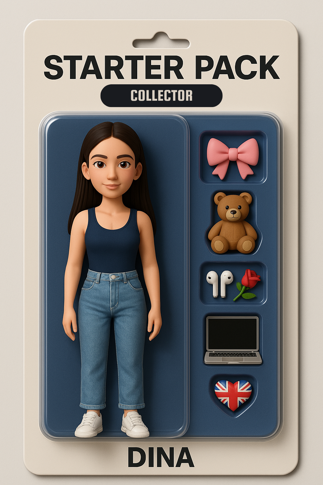

  

 

<table align="center" width="95%" cellpadding="10" cellspacing="0" style="border-collapse: collapse; border: none; border-spacing: 0;">
  <tr>
    <td align="center" width="250" style="border: none; border-style: none; vertical-align: top;">
      
    </td>
    <td style="text-align: left; padding-left: 25px; border: none; border-style: none; vertical-align: top;">
      

        🎓 <strong>Computer Science Engineering Student</strong> @ <a href="https://www.epita.fr" target="_blank" style="color: #89B4FA; text-decoration: none; font-weight: bold;">EPITA</a> (Paris), specializing in <strong>Cybersecurity & Systems</strong>. 
        ⚙️ Currently working as an <strong>Apprentice Engineer</strong>, focusing on <strong>Backend Development</strong> (Java/Quarkus) and <strong>DevOps practices</strong> (Docker, Kubernetes, CI/CD). 
        🛡️ <strong>Aspiring DevSecOps / Cloud Security Engineer</strong> — passionate about: <strong>Cloud Infrastructure</strong>, <strong>Securing CI/CD</strong>, <strong>AI & Agent Tooling</strong>, <strong>System Administration</strong> (Linux/Arch), and low-level systems programming. 
        💡 Driven by: Building resilient, scalable, and secure architectures from the ground up.
      

       

         🌐 Discover more on my website: <a href="https://dina-didouche.fr" target="_blank" style="color: #89B4FA; text-decoration: none; font-weight: bold;">dina-didouche.fr</a>
       

    </td>
  </tr>
</table>

---

## 🛠️ Tech Stack & Skills

### ☁️ DevOps, Cloud & Systems

  &nbsp;&nbsp;&nbsp;
  &nbsp;&nbsp;&nbsp;
  &nbsp;&nbsp;&nbsp;
  &nbsp;&nbsp;&nbsp;
  &nbsp;&nbsp;&nbsp;
  &nbsp;&nbsp;&nbsp;
  &nbsp;&nbsp;&nbsp;
  &nbsp;&nbsp;&nbsp;
  

### 💻 Backend & Systems Programming

  &nbsp;&nbsp;&nbsp;
  &nbsp;&nbsp;&nbsp;
  

### ⚙️ Systems & Development Environment

  &nbsp;&nbsp;&nbsp;
  &nbsp;&nbsp;&nbsp;
  &nbsp;&nbsp;&nbsp;
  &nbsp;&nbsp;&nbsp;
  

### 🌐 Web & Mobile Development

  &nbsp;&nbsp;&nbsp;
  &nbsp;&nbsp;&nbsp;
  &nbsp;&nbsp;&nbsp;
  &nbsp;&nbsp;&nbsp;
  

---

## 🔭 Projects Showcase

* 🧠 [**S3 Project "Hidden Palace" (EPITA)**](https://github.com/dinaosaure/HiddenPalace): Optical Character Recognition (OCR) and word search solver built entirely in **C**, including custom Neural Network development and low-level memory management. *(C / Neural Network)*
* ⚙️ [**VIM Configuration & Dotfiles**](https://github.com/dinaosaure/VIM_config_dinaosaure): Personal **Arch Linux**, i3wm, and **Vim** configuration files, demonstrating daily comfort with Unix-like systems, CLI tooling, and workflow automation. *(Vimscript / Bash)*
* 🤖 **AI Agents & Custom Skills**: Designing custom agent skills and automated workflows for AI coding assistants and LLM tooling (Agentic workflows, prompt architecture & context management). *(AI Agents / LLM Tooling)*
* 🌐 **Infrastructure Automation & DevSecOps Lab** *(Work in Progress)*: Designing resilient deployment architectures and secure CI/CD pipelines (Docker containerization, GitLab CI, security scanning & automation). *(DevSecOps / Cloud)*
* 📱 [**GreenWatch App (UPM)**](https://github.com/lucasbnrd05/flutter_app): Flutter app with a Kotlin backend monitoring drought and flood impacts using real-time data & sensors. *(Flutter / Kotlin)*
* 🧩 **AFIT (EPITA)**: Transcription and formalization of advanced arithmetic algorithms into **OCaml**. *(OCaml, private repository)*
* [**Video Game "Devs" (EPITA)**](https://github.com/CelinaMeiLin/SUPERDEVS): Led the development of a rogue-like game. 🎮 *(C# / Godot Engine)*
* ✨ [**Personal Website**](https://github.com/dinaosaure/dinaosaure.github.io): Portfolio site built with HTML, CSS, JS, hosted on GitHub Pages.

---

## 🌱 Beyond the Code

  Actively volunteering with <a href="https://prologin.org/" target="_blank" style="color: #89B4FA;">Association Prologin</a>, introducing CS concepts in schools and through <a href="https://girlscancode.fr/" target="_blank" style="color: #89B4FA;">"Girls Can Code!"</a> stages! 👩‍💻 
  🎵 Also a passionate musician with a Certificate of Musical Studies (CEM) – playing Violin 🎻 & Piano 🎹 after years at the conservatory.

---

## 📫 Let's Connect!

Feel free to reach out or connect with me:

  
  
  
  

---

  

 

